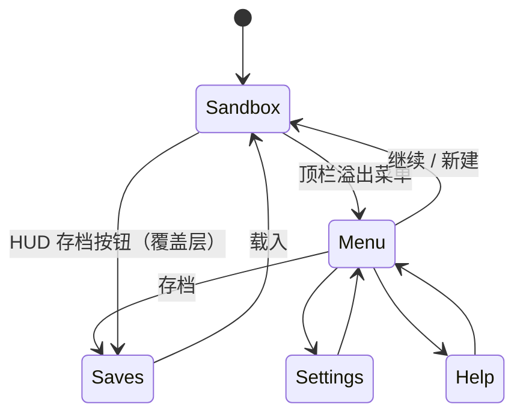
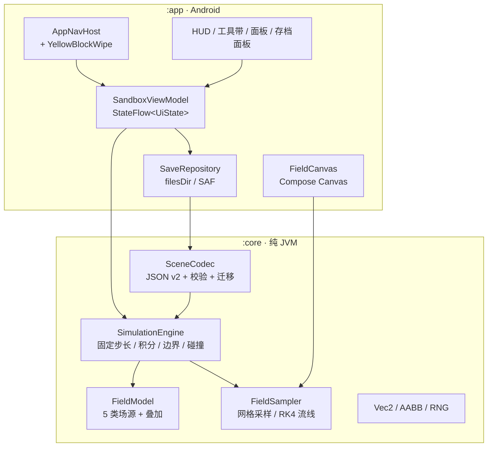

# Field Lab · Android 2D 场模拟沙盒 设计文档

| 项目 | 内容 |
| --- | --- |
| 版本 | v0.2（草案） |
| 日期 | 2026-10-31 |
| 状态 | 待评审 |
| 平台 | Android 原生（横屏优先） |
| 技术栈 | Kotlin 2.x + Jetpack Compose + 自研场引擎 |
| 最低版本 | Android 8.0（API 26），targetSdk 35 |

> v0.1 曾是"浏览器 2D 刚体沙盒（TypeScript + Canvas）"。本版按新的产品方向**整体重写**：平台改为 Android，核心从"刚体堆叠"改为"多种物理场 + 探针粒子"，UI 采用 Mindustry 风格，并新增页面过渡动画规范。

---

## 1. 定位与核心循环

**Field Lab** 是一个 Android 端的 2D 场模拟沙盒：在一个俯视世界里摆放场源（电荷、磁体、质量体、阻力区、均匀力场），发射/放置探针粒子，实时观察它们在**电场、磁场、重力场、引力场、阻力场**中的运动轨迹。

Mindustry 的 UI 是"信息密度高、操作就地完成"的游戏化界面：没有独立编辑器，所有编辑都发生在当前世界里。本产品沿用这种交互哲学——**打开即进入世界，所有参数、工具、存档操作都在世界内完成**。

核心循环：

```text
进入世界 → 选择工具 → 摆放/调整场源 → 投放探针 → 观察轨迹与场可视化
      ↑                                              ↓
      └────────── 调参（强度/方向/介质/可视化） ←─────┘
```

---

## 2. 目标与非目标

### 2.1 目标（v0.1 必须达成）

1. **五类场**：电场、磁场、重力场（均匀）、引力场（平方反比源）、阻力场（区域/全局），支持任意叠加。
2. **场可视化**四种模式：矢量箭头、流线（磁力线/电场线）、标量热图（势能/场强）、探针轨迹。
3. **探针粒子系统**：质量、电荷、半径、拖尾；可发射、可拖拽、可删除。
4. **就地编辑**：工具带选源 → 点击放置 → 拖动调整 → 长按删除；撤销/重做 20 步。
5. **Mindustry 风格 UI**：深色扁平面板、直角、黄色强调色、底部工具带、右侧参数面板。
6. **黄色斜块划屏转场**：所有页面切换统一使用该动画，支持"减弱动画"。
7. **存档内操作**：世界内即可保存/读取/重命名/删除/导出，无需退出到编辑器。
8. **性能**：中端机 2000 探针 + 30 场源稳定 60 FPS；低端机自动降档 30 FPS。

### 2.2 非目标（v0.1 明确不做）

- 3D、软体、流体（PBF 流体列入 v0.3 实验）。
- 多边形刚体堆叠 / 关节（v0.1 只做圆形探针与静态墙体碰撞；原刚体求解器整体移出范围）。
- 联网、云同步、多人协作。
- iOS / 桌面端（后续用 Kotlin Multiplatform 迁移，见 §16 开放问题）。
- 用户脚本 API。

---

## 3. 核心概念

| 概念 | 说明 |
| --- | --- |
| **世界（World）** | 一个矩形边界内的模拟空间，含边界行为、固定步长、相机 |
| **场源（FieldSource）** | 产生场的对象：点电荷、磁体、质量体、阻力区、均匀力场 |
| **场（Field）** | 由若干场源叠加得到的空间向量/标量函数，统一接口 `FieldModel.sample()` |
| **探针（Probe）** | 受场作用的小球粒子，拥有质量、电荷、半径、拖尾历史 |
| **场视图（FieldView）** | 场的可视化表现；与物理模拟解耦，可独立开关与调参 |
| **存档（Session）** | 世界 + 场源 + 探针 + 相机 + 可视化设置的完整快照（JSON v2） |

---

## 4. 场系统设计（核心）

### 4.1 统一接口

所有场源实现同一套采样接口，物理与可视化共用，避免"物理算一套、画图算另一套"。

```kotlin
// :core 纯 Kotlin，无 Android 依赖
data class FieldSample(
    val electric: Vec2 = Vec2.ZERO,      // E，供带电粒子受力
    val magneticBz: Double = 0.0,        // B 的 z 分量（垂直屏幕向外）
    val gravity: Vec2 = Vec2.ZERO,       // g（均匀重力 + 引力叠加）
    val dragLinear: Double = 0.0,        // 线性阻力系数 c1
    val dragQuadratic: Double = 0.0,     // 二次阻力系数 c2
    val wind: Vec2 = Vec2.ZERO,          // 介质流速（阻力相对速度用）
    val potential: Double = 0.0          // 标量势（热图/等势线用）
)

interface FieldSource {
    val id: Long
    fun accumulate(p: Vec2, t: Double, out: FieldSample)  // 就地累加，热路径零分配
}
```

**采样是就地累加**：`World.sample(p)` 复用模块级 `FieldSample` 实例，避免每个粒子每步分配对象。

### 4.2 五类场

| 场 | 源类型 | 数学定义（软化后） | 对探针的作用 | 可视化 |
| --- | --- | --- | --- | --- |
| 电场 | 点电荷 `q` | `E = k Σ q_i (p - p_i) / (d² + ε²)^{3/2}` | `a += q_probe·E / m` | 场线（正→负）、箭头、势热图 |
| 磁场 | 磁体（两个磁极） | `Bz = k_m Σ ±m_i / (d² + ε²)`，磁极 N/S 各一 | `a += q·Bz·(vy, -vx) / m`（洛伦兹力，2D） | 磁力线（N→S）、箭头 |
| 重力场 | 均匀场 | `g = (gx, gy)` | `a += g` | 箭头（统一色） |
| 引力场 | 质量体 `M` | `g += G M_i (p - p_i) / (d² + ε²)^{3/2}` | `a += g` | 箭头、势热图 |
| 阻力场 | 区域 + 全局 | `F = -(c1·v_rel + c2·|v_rel|·v_rel)`，`v_rel = v - wind` | `a += F / m` | 区域斜纹填充 + 风向箭头 |

补充的两种（低成本、强表现力，建议 v0.1 一并实现）：

| 场 | 说明 |
| --- | --- |
| **均匀力场** | 任意方向的常加速度，用于"风/斜面/传送带"式实验 |
| **边界墙** | 静态矩形/线段，参与碰撞，不产生场 |

> 磁场的 2D 建模说明：真实 3D 磁偶极在屏幕平面内无法严格降维，这里用"两个磁极（磁荷）"近似，`Bz` 为垂直屏幕分量，磁力线在平面内表现为 N→S 的曲线。这是可视化友好的近似，不是严格电磁学；文档与 UI 中明确标注"演示模型"。

### 4.3 单位与常量

为让滑杆数值友好，采用**无量纲"模拟单位"**，不直接使用 SI：

| 常量 | 默认值 | 说明 |
| --- | --- | --- |
| `kE`（电场常数） | `1.0` | 等价于 `1/(4πε₀)` 的缩放版 |
| `kM`（磁场常数） | `1.0` | 磁极强度 → Bz 的比例 |
| `G`（引力常数） | `1.0` | 质量 → 加速度的比例 |
| 软化 `ε` | `0.05 m` | 防止 `1/r²` 奇点；`ε²` 加在分母内 |
| 世界尺度 | 40 m × 24 m | 横向视野，配合 24 px/m 默认缩放 |

所有常量可在"高级参数"面板调整；默认值保证"一个单位电荷在 1 m 外产生约 1 的加速度"的可感知量级。

### 4.4 叠加顺序与采样

```text
sample(p) = Σ_sources.accumulate(p, t)
```

- 电场、引力场、重力场、阻力场、风场都直接线性叠加。
- 阻力系数与风速按区域**累加后钳制**（`c1 + c2 ≤ cMax`），避免重叠区域出现"无限黏滞"。
- 场源数量上限：200（v0.1），超过拒绝并提示。
- 采样复杂度 `O(源数)`；2000 探针 × 20 源 × 2 子步 = 8 万次采样/帧，Kotlin 上完全可控。
- 优化：为每个源缓存影响半径（如阻力区、带截断的引力源），超出半径直接跳过。

### 4.5 场线 / 流线追踪

- 使用 **RK4** 积分：`p_{n+1} = p_n + h·(k1 + 2k2 + 2k3 + k4)/6`，步长 `h = 0.15 m`，最多 240 步。
- 种子策略：
  - 电场线：每个正电荷周围均匀撒 12 个种子，沿 `+E` 方向追踪，遇负电荷或出界停止。
  - 磁力线：从每个磁体的 N 极撒 10 个种子，沿 `Bz` 方向追踪到 S 极。
  - 阻力/风场：均匀网格种子，沿速度场追踪。
- 结果缓存为 `List<Polyline>`，**仅在源变化或参数变化时重算**（脏标记），不逐帧计算。
- 视觉：细线 + 沿线渐变透明度 + 方向小箭头；单帧绘制上限 6000 段。

### 4.6 数值稳定性

| 风险 | 处理 |
| --- | --- |
| `1/r²` 奇点 | 软化 ε；超过 `d < 0.02 m` 时按最小距离计算（力上限） |
| 高速粒子穿出边界 | 速度钳制 60 m/s；边界碰撞用连续检测（圆 vs 边） |
| 刚性阻尼导致爆炸 | 阻力系数钳制；半隐式积分对线性阻尼无条件稳定 |
| NaN | 每步 `isFinite` 检查；命中即冻结该探针并标记 `faulted`（红色描边），不影响其他粒子 |
| 长时间能量漂移 | 提供 RK4 积分器选项（4× 成本）；半隐式为默认 |

---

## 5. 实体与动力学

### 5.1 探针粒子

| 属性 | 类型 | 默认 | 说明 |
| --- | --- | --- | --- |
| `position` | Vec2 | — | 世界坐标（米） |
| `velocity` | Vec2 | `(0,0)` | 米/秒 |
| `mass` | Double | 1.0 | 参与 `a = F/m` |
| `charge` | Double | 1.0 | 电场与磁场的耦合强度，可为负 |
| `radius` | Double | 0.12 | 碰撞与绘制半径 |
| `dragScale` | Double | 1.0 | 个体阻力倍率（与介质系数相乘） |
| `trail` | 环形缓冲 32 点 | 开 | 轨迹拖尾 |
| `faulted` | Boolean | false | NaN 守卫标记 |

### 5.2 边界与碰撞

- 边界模式：`reflect`（默认）/ `wrap`（环绕）/ `open`（飞离后移除）。
- 探针-探针碰撞：可选开关（默认**开**），圆-圆弹性碰撞，按质量加权冲量，恢复系数 0.2。
- 探针-墙碰撞：圆 vs 轴对齐矩形/线段最近点，位置投影 + 法向速度反射。
- 宽相：探针数 > 200 时启用空间哈希（单元格 2× 最大半径）；小于 200 直接两两检测。
- 高速穿隧：单步位移超过半径时，对该粒子做 2–8 次子步细分（仅碰撞判定，场力仍按整步积分）。

### 5.3 积分器与时间步

| 项 | 默认 | 可选 |
| --- | --- | --- |
| 固定步长 | `1/60 s` | 1/120 – 1/30 |
| 子步 | 2 | 1 – 4 |
| 积分器 | 半隐式 Euler | RK4（精度优先） |
| 倍速 | 1× | 0.25× / 0.5× / 1× / 2× / 4× |
| 暂停/单步 | 支持 | — |

固定步长 + 累加器与渲染解耦；`dt` 钳制 0.25 s，最多 4 子步，超限丢弃余额（避免"死亡螺旋"）。

### 5.4 世界内操作

| 操作 | 行为 |
| --- | --- |
| 点击工具带槽位 | 选中"待放置源"类型（电荷 +/−、磁体、质量体、阻力区、均匀力场、墙、橡皮） |
| 点击空白 | 按当前工具放置源 / 选中探针 |
| 拖动源 | 移动源（实时重算场） |
| 拖动空白 | 平移世界 |
| 双指捏合 | 缩放（0.5×–4×） |
| 长按源 | 弹出删除确认（Mindustry 风格小面板） |
| 双指长按 | 快速投放探针（可选） |
| 顶部"+" | 打开探针发射面板（数量、初速度、电荷、散布角） |

撤销栈：命令模式记录"增删改"操作，容量 20，UI 提供撤销/重做按钮（放在顶栏，不占手势）。

---

## 6. 渲染与可视化

### 6.1 渲染技术选择

**v0.1 使用 Compose Canvas**（单线程、`withFrameNanos` 驱动），理由：

- 与 HUD 共用一套 Compose 状态，开发与调试成本最低。
- 2000 个探针用 `drawPoints` 批量绘制可稳定 60 FPS；场热图用预计算 `ImageBitmap` 上屏，避免逐像素采样。
- 预留降级路径：若低端机实测掉帧，将 `FieldCanvas` 替换为 `SurfaceView + 独立绘制线程`，对上层接口不变（详见 §12）。

渲染层序（自下而上）：

```text
1 背景网格（自适应稀疏，缩放 < 0.4 隐藏次级网格）
2 场热图（可选，ImageBitmap，最近邻缩放）
3 场线 / 流线（可选）
4 矢量箭头网格（可选，默认开）
5 阻力区 / 磁场区域底纹
6 墙体与边界
7 场源图标（+ / − / N/S / 质量符号）
8 探针拖尾 + 探针本体
9 选中高亮、放置预览（半透明）
10 调试层（受力矢量、速度、FPS/计数）
```

### 6.2 四种可视化模式

| 模式 | 实现 | 刷新策略 | 默认 |
| --- | --- | --- | --- |
| **矢量箭头** | 24×14 网格采样，箭头长度按 `log1p(|F|)` 归一化，头部小三角 | 源变化时重算（脏标记） | 开 |
| **流线 / 场线** | RK4 追踪，见 §4.5 | 源变化时重算 | 开（仅电场/磁场） |
| **标量热图** | 96×54 网格采样 → ARGB 色带 → `ImageBitmap` | 源变化或每 500ms | 关 |
| **探针轨迹** | 每粒子环形缓冲 32 点，渐隐折线 | 逐帧 | 开 |

配色与场的语义绑定（同时满足色弱可辨，用形状辅助区分）：

| 场 | 主色 | 辅助 |
| --- | --- | --- |
| 电场 | `#4FD1FF` 青 | 箭头 + 场线 |
| 磁场 | `#FF7BD5` 品红 | 虚线磁力线 |
| 重力 / 引力 | `#FFD37F` 黄 | 实心箭头 |
| 阻力 | `#7EE787` 绿 | 45° 斜纹填充 |
| 均匀力场 | `#C792EA` 紫 | 大箭头 |

### 6.3 相机与坐标

- 世界坐标：米，Y 轴向上；屏幕坐标 Y 轴向下，渲染时翻转。
- 相机：`center: Vec2`、`zoom: Float`（px/m，默认 24）。
- 手势变换采用"指针锚点缩放"：缩放前后手指下的世界点保持不动。
- 屏幕外剔除：按世界 AABB 与视口求交，跳过绘制。

### 6.4 性能预算

| 指标 | 中端机（60 FPS） | 低端机（30 FPS） |
| --- | --- | --- |
| 探针 | 2000 | 800 |
| 场源 | 30 | 30 |
| 物理耗时 | ≤ 6 ms/帧 | ≤ 12 ms/帧 |
| 渲染耗时 | ≤ 6 ms/帧 | ≤ 14 ms/帧 |
| 热图网格 | 96×54 | 64×36 |
| 拖尾点数 | 32 | 12 |
| 场线总段数 | 6000 | 2500 |

降档策略：连续 30 帧超预算 → 自动降一档，并在状态栏提示（可关闭自动降档）。

---

## 7. UI 设计（Mindustry 风格）

### 7.1 视觉规范

| Token | 值 | 用途 |
| --- | --- | --- |
| `bg` | `#171A1E` | 世界底色 |
| `surface` | `#262B31` | 面板背景 |
| `surfaceRaised` | `#313840` | 按钮 / 槽位 |
| `border` | `#48515B` | 1–2dp 描边 |
| `accent` | `#FFD37F` | 主强调色（黄色） |
| `accentDark` | `#D9A94B` | 按下态 / 斜块阴影 |
| `textPrimary` | `#E8EDF2` | 主文字 |
| `textSecondary` | `#98A3AE` | 次要文字 |
| `danger` | `#FF6B5E` | 删除 / 错误 |
| `grid` | `#2B3036` | 网格线 |

- **圆角 0dp**，全部直角；面板用 1dp 描边 + 顶部 2dp 强调色条（Mindustry 的标志性做法）。
- 标签用**全大写 + 字距 1.2sp**；数值用等宽数字（`FontFeatureSettings("tnum")`）。
- 字体：系统 sans；可选打包 `Oxanium`（SIL OFL）作为标题字体。
- 图标线条 2dp，24dp 画布，选中态用黄色描边 + 内发光（`0x33FFD37F`）。
- 面板进入/收起：从右侧滑入 180ms + 透明度渐显；不做弹性回弹。

### 7.2 布局（横屏）

```text
┌───────────────────────────────────────────────────────────────┐
│ HUD: FIELD LAB · 世界名 · t=12.4s · 探针 240 · 60FPS   [↶][↷][⏸][💾] │
├──────────────────────────────────────────┬────────────────────┤
│                                          │  右侧面板（可收起）   │
│                                          │  ├ 场参数            │
│              世界 Canvas                  │  ├ 可视化            │
│                                          │  ├ 探针发射          │
│                                          │  └ 检查器            │
│                                          │                     │
├──────────────────────────┬───────────────┴────────────────────┤
│ 工具带 8 槽（2×4）        │ ▶ ⏸ ⏭  ×1   [重置]   [存档]  [帮助]  │
└──────────────────────────┴────────────────────────────────────┘
```

- 顶栏高 52dp；底部栏高 72dp；右侧面板宽 300dp（平板 340dp）。
- 竖屏：世界占上半 55%，面板变为底部抽屉（高度 45%，可拖动），工具带改为横向滚动单行。
- 小屏（< 600dp 宽）：右侧面板默认收起，用图标按钮唤出。

### 7.3 组件清单

| 组件 | 内容 | 行为 |
| --- | --- | --- |
| **顶栏 HUD** | 标题、世界名、模拟时间、探针数、FPS、撤销/重做、暂停、存档 | 点击世界名可重命名 |
| **工具带** | 8 个槽位：正电荷、负电荷、磁体、质量体、阻力区、均匀力场、墙、橡皮 | 点击选中；选中槽位黄色描边 + 图标放大 1.15× |
| **时间控制条** | 播放/暂停、单步、倍速循环、重置 | 长按倍速显示 5 档选择 |
| **右侧参数面板** | 分节手风琴：场参数（各场开关/强度）、可视化（模式/透明度）、探针发射、检查器 | 收起时只留 48dp 竖直标签条 |
| **检查器** | 选中源/探针的属性滑杆与数值输入 | 修改立即生效；滑杆带"长按复位" |
| **存档面板** | 槽位卡片列表（名称、时间、探针数、缩略色块） | 保存/读取/重命名/删除/复制/导出；长按卡片弹出操作菜单 |
| **Toast / 提示** | 顶部滑入的短提示（Mindustry 风格小方条） | 2.5s 自动消失；错误用红色描边 |
| **空状态** | 无场源时提示"从底部工具带选择一个场源" | 首次进入显示 3 步引导遮罩 |

### 7.4 手势与工具状态机

工具状态：`SELECT`（默认）/ `PLACE`（已选源类型）/ `ERASE` / `PAN`。

- 点击判定：按下与抬起位移 < 8dp 且时长 < 300ms。
- 拖动：位移 ≥ 8dp 即进入拖拽（移动源或平移世界，按起点命中对象决定）。
- 双指：捏合缩放 + 双指平移；期间屏蔽单指编辑。
- `PLACE` 模式拖动空白 = 平移，避免误放；点击空白才放置。
- 放置预览：跟随手指的半透明源图标 + 有效/无效（与已有源过近时红色）。
- 触控目标 ≥ 48dp；工具槽 56dp。

### 7.5 "存档内操作"的具体落地

- 应用启动直接进入**上次世界**（自动存档），不经过菜单；主菜单从顶栏溢出菜单进入。
- 所有保存/读取都是**覆盖层**（世界不卸载、模拟不重置，读取时才替换状态）。
- 保存时若已有同名槽位：询问"覆盖 / 另存为"。
- 自动保存：每 15s 且世界有变更时写 `autosave.field.json`；切后台立即保存。
- 读档前若当前世界有未保存变更：提示"保存并读取 / 直接读取 / 取消"。

### 7.6 无障碍与本地化

- 所有图标按钮有 `contentDescription`；TalkBack 可读。
- 触控目标 ≥ 48dp；对比度 ≥ 4.5:1（强调黄在深底上对比度足够，仅用于描边/图标，不用作小号正文）。
- 跟随系统"动画时长缩放"：为 0 时转场改为 120ms 淡入淡出。
- 中文 / 英文两套 `strings.xml`；数值与单位本地化（`m/s`、`G` 等不翻译）。

---

## 8. 导航与过渡动画

### 8.1 页面与导航图

为完全控制转场，导航不使用 Navigation-Compose，而是自研轻量栈（`sealed class Screen` + `ArrayDeque` + 状态），这样才能让"黄色斜块覆盖层"统一接管所有切换。



- 首次启动：显示 3 步引导（世界内遮罩，不走页面切换）。
- 之后启动：直接恢复到上次世界（Sandbox）。
- 覆盖层类界面（存档、设置、帮助）也可以"页"形式出现，统一走同一套转场。

### 8.2 黄色斜块划屏转场（核心规范）

**视觉**：6 块平行四边形黄色斜块从屏幕左侧依次扫入，铺满全屏，内容在中点切换，随后斜块继续向右扫出，露出新页面。斜块之间保留 2dp 深黄缝隙，形成"斜纹块"感。

**参数**：

| 参数 | 值 | 说明 |
| --- | --- | --- |
| 总时长 | 520 ms | 过快看不清块感，过慢显拖沓 |
| 块数 | 6 | 手机上每块约 1/6 屏宽 |
| 单块宽度 | `W/6 × 1.5 + skew` | 1.5 倍重叠，确保扫过期间无缝隙穿透 |
| 斜切量 | `skew = H × 0.35` | 约 19° 斜角 |
| 块间距 | 2 dp | 深黄色缝隙 |
| 块启动错峰 | 45 ms | 形成"依次划过" |
| 内容切换时刻 | 260 ms（50%） | 全屏被覆盖最稳的时刻 |
| 颜色 | `#FFD37F` / `#F2B94F` / `#E6A63C` 交替 | 加 2dp `#8A6420` 前沿描边 |
| 缓动 | `FastOutSlowInEasing` | 整体线性推进 + 单块缓动 |
| 输入 | 全程拦截 | 覆盖层全屏 `pointerInput` 吞掉事件 |
| 减弱动画 | 120 ms 交叉淡入淡出 | 系统动画缩放为 0 时 |

**时序**：

```text
0ms ─────────── 260ms ─────────── 520ms
│ 斜块扫入(错峰) │   斜块扫出      │
│                ↑ 内容已切换      │
```

**实现要点**：

- 覆盖层放在根 `Box` 的 `zIndex(20f)`，高于 HUD 与面板。
- 单块进度 = `clamp((t*D - i*stagger) / blockDuration)`，块本身 `FastOutSlowInEasing`；整体 `p` 为 0..1 线性。
- 斜块路径在尺寸变化时**预计算为 `Path`**，绘制时仅 `translate`，不在每帧 `Path` 中分配。
- 内容切换由 `onMidpoint` 回调触发导航；`AnimatedContent` 本身用 0ms 切换（避免与斜块动画叠加出"双重动画"）。
- 覆盖层自身 `alpha` 在 0 和 1 两端保持不透明，避免首尾闪白。

```kotlin
@Composable
fun YellowBlockWipe(
    visible: Boolean,
    onMidpoint: () -> Unit,
    onFinished: () -> Unit,
) {
    val p = remember { Animatable(0f) }
    val scope = rememberCoroutineScope()
    LaunchedEffect(visible) {
        if (!visible) return@LaunchedEffect
        p.snapTo(0f)
        p.animateTo(1f, tween(520, easing = LinearEasing))
        onFinished()
    }
    Canvas(Modifier.fillMaxSize().zIndex(20f)) {
        val t = p.value
        if (t <= 0f || t >= 1f) return@Canvas
        if (t >= 0.5f) onMidpoint()   // 仅触发一次，需用旗标去重
        val skew = size.height * 0.35f
        val blockW = size.width / 6f * 1.5f + skew
        repeat(6) { i ->
            val local = ((t * 520f - i * 45f) / 520f).coerceIn(0f, 1f)
            val eased = FastOutSlowInEasing.transform(local)
            val x = -blockW + eased * (size.width + blockW * 2f)
            val path = Path().apply {
                moveTo(x + skew, 0f)
                lineTo(x + blockW + skew, 0f)
                lineTo(x + blockW, size.height)
                lineTo(x, size.height)
                close()
            }
            drawPath(path, color = blockColor(i))
        }
    }
}
```

> 代码为规范示意，正式实现需把 `Path` 缓存到 `drawWithCache`、把中点回调移到 `LaunchedEffect` 的 `snapshotFlow`，并处理"内容在 mid 之后不可见"的 20ms 容错。

### 8.3 其他微动效

| 场景 | 动画 |
| --- | --- |
| 工具槽选中 | 描边高亮 90ms + 图标 scale 1→1.15 |
| 右侧面板展开/收起 | 宽度/透明度 180ms，`FastOutSlowInEasing` |
| 按钮按下 | 背景色下沉 + scale 0.97，80ms |
| Toast | 顶部滑入 200ms，停留 2.5s，淡出 150ms |
| 存档卡片列表 | 40ms 错峰淡入（仅首次进入） |
| 放置预览 | 跟随指针，无动画（保证即时感） |

---

## 9. 存档与数据

### 9.1 场景 JSON v2

```json
{
  "version": 2,
  "name": "Dipole",
  "world": { "bounds": [-20, -12, 20, 12], "boundary": "reflect" },
  "settings": {
    "fixedDt": 0.0166666667,
    "subSteps": 2,
    "integrator": "semiImplicit",
    "speed": 1.0,
    "collisions": true
  },
  "sources": [
    { "id": 1, "type": "charge", "position": [-3, 0], "charge": 2.0 },
    { "id": 2, "type": "charge", "position": [3, 0], "charge": -2.0 },
    { "id": 3, "type": "magnet", "position": [0, 4], "strength": 1.0, "angle": 0 },
    { "id": 4, "type": "mass", "position": [0, -5], "mass": 8.0 },
    { "id": 5, "type": "dragRegion", "shape": { "type": "rect", "center": [8, 0], "size": [6, 12] },
      "linear": 0.6, "quadratic": 0.1, "wind": [0.8, 0] },
    { "id": 6, "type": "uniformForce", "accel": [0, -3] },
    { "id": 7, "type": "wall", "shape": { "type": "rect", "center": [0, -8], "size": [40, 1] } }
  ],
  "probes": [
    { "id": 1, "position": [0, 2], "velocity": [1, 0], "mass": 1, "charge": 1, "radius": 0.12 }
  ],
  "camera": { "center": [0, 0], "zoom": 24 },
  "visuals": { "arrows": true, "streamlines": true, "heatmap": false, "trails": true }
}
```

校验规则：

- 解析后必须通过 `SceneValidator`；错误**字段级**返回（如 `sources[4].shape.size: 必须为正数`），不做静默兜底。
- `id` 唯一；缺失时自动补号并提示。
- 未知字段保留在 `extras` 中，保证向前兼容。
- 导出数值保留 6 位小数；`migrate()` 按版本逐级升级，写入永远输出当前版本。

### 9.2 存储与导入导出

| 项 | 方案 |
| --- | --- |
| 内部存档 | `context.filesDir/saves/*.field.json`，槽位索引扫描目录（无数据库） |
| 自动存档 | `filesDir/autosave.field.json`，15s 或切后台时写入 |
| 导出 | SAF `ACTION_CREATE_DOCUMENT`（`application/json`），无需存储权限 |
| 导入 | SAF `ACTION_OPEN_DOCUMENT`，读取后校验并另存为新槽位 |
| 分享 | `ACTION_SEND` 附带 JSON 文件 |
| 缩略图 | 不落盘图片；槽位卡片用主色块 + 文字元数据，避免存储成本 |

### 9.3 自动保存与异常恢复

- 写入使用"临时文件 + rename"原子替换，避免断电损坏。
- 启动时若 `autosave` 解析失败：保留损坏副本 `autosave.corrupt.json`，提示用户，回退到最近成功槽位。
- 世界变更标记：源/探针增删改、参数变更、相机变更都会置脏；只聚焦暂停时也保存一次（避免误触丢失）。

---

## 10. 工程架构

### 10.1 技术栈

| 维度 | 选择 | 版本/说明 |
| --- | --- | --- |
| 语言 | Kotlin | 2.0+，`explicitApi` 关闭，JVM target 17 |
| UI | Jetpack Compose + Material3（仅用基础组件，主题全面定制） | BOM 2024.09+ |
| 构建 | Gradle KTS + Version Catalog | AGP 8.6+ |
| minSdk / target | 26 / 35 | Android 8.0 起 |
| 渲染 | Compose Canvas（降级路径 SurfaceView） | — |
| 序列化 | kotlinx.serialization JSON | 避免反射 |
| 异步 | Kotlin Coroutines + StateFlow | 单线程模拟 |
| 测试 | JUnit4（core）+ Compose UI Test + Robolectric（少量） | — |
| 静态检查 | ktlint + detekt + Android Lint | CI 门禁 |
| 分发 | GitHub Releases（APK） | 后续考虑 Play Store |

### 10.2 模块划分



- `:core` 无 Android 依赖，可在 JVM 上跑全部物理与场测试，保证可回归、可基准。
- UI 只读 `UiState`（含 `FrameSnapshot`），所有变更通过 `Intent`/方法调用写入 `ViewModel`，禁止 UI 直接持有引擎。
- 依赖注入：v0.1 手动构造（`AppContainer`），不引入 Hilt，减少构建复杂度。

### 10.3 目录结构

```text
field/
├─ core/                                  # 纯 Kotlin 库
│  └─ src/main/kotlin/dev/field/core/
│     ├─ math/                            # Vec2, AABB, 插值, RNG
│     ├─ fields/                          # FieldSource 与五类实现
│     ├─ sim/                             # SimulationEngine, Probe, World, 碰撞
│     ├─ viz/                             # 网格采样, RK4 追踪, 色带
│     ├─ scene/                           # Scene 模型 + 编解码 + 迁移
│     └─ util/                            # 冻结/NaN 守卫/诊断
├─ app/
│  └─ src/main/kotlin/dev/field/app/
│     ├─ MainActivity.kt
│     ├─ nav/                             # Screen, stack, AppNavHost
│     ├─ transition/                      # YellowBlockWipe
│     ├─ ui/theme/                        # 颜色/字体/尺寸 token
│     ├─ ui/sandbox/                      # FieldCanvas, HUD, 工具带, 面板
│     ├─ ui/saves/                        # 存档槽位
│     ├─ ui/settings/
│     ├─ ui/help/
│     └─ data/                            # SaveRepository, SAF
├─ app/src/main/res/                       # strings (zh/en), icons, themes
├─ tests/  (core/src/test, app/src/androidTest)
├─ gradle/libs.versions.toml
├─ settings.gradle.kts
└─ build.gradle.kts
```

### 10.4 线程模型

- 模拟与渲染在主线程，由 `withFrameNanos` 驱动（v0.1）：状态无竞争、实现最简单。
- 场热图/流线的重算在 `Dispatchers.Default` 后台执行，完成后 `withContext(Main)` 发布 `ImageBitmap`/`List<Polyline>`，主线程仅绘制。
- 若性能不达标则切换到"模拟独立线程 + 双缓冲快照"（`FieldCanvas` 接口不变），该方案在 §12 中作为备选。
- 切后台：`ON_STOP` 暂停模拟并保存；恢复时不补偿时间（避免一次跳很多步）。

---

## 11. 性能与功耗

| 档位 | 判定 | 粒子 | 子步 | 拖尾 | 热图 | 目标 |
| --- | --- | --- | --- | --- | --- | --- |
| 高 | 8 核 / 2022 年后 | 4000 | 2 | 32 | 96×54 | 60 FPS |
| 中 | 主流 | 2000 | 2 | 24 | 96×54 | 60 FPS |
| 低 | 入门 | 800 | 1 | 12 | 64×36 | 30 FPS |

- 无每帧分配：`FieldSample`、临时 `Vec2`、接触数组全部复用；`Probe` 用 `ArrayList` + 对象池增长。
- 探针绘制按数量切换：≤ 400 用 `drawCircle`（带描边），> 400 用 `drawPoints`（`PointMode.Points` + 圆头），跳过描边。
- 热图仅在脏标记或 500ms 节流时重算，使用 `IntArray` → `ImageBitmap`。
- 暂停、无变更、切后台时不重绘；`invalidate` 由状态驱动。
- 电池保护：可开启"省电模式"（30 FPS + 关闭拖尾 + 关闭热图）。
- 场源与探针上限固定，内存峰值可控（目标 < 120MB）。

---

## 12. 测试与 CI

| 层级 | 内容 | 工具 |
| --- | --- | --- |
| 数学单元 | Vec2/AABB、RK4 精度、软化函数 | JUnit + kotlin.test |
| 场解析 | 点电荷场强 `1/r` 衰减、偶极子对称性、洛伦兹力垂直于速度且不做功、阻力终端速度 `v_t = sqrt(mg/c2)` | JUnit（容差断言） |
| 模拟行为 | 半隐式 vs RK4 能量误差、边界三种模式、碰撞不重叠、NaN 守卫 | JUnit 无头 |
| 确定性 | 600 步回放快照，位置容差 1e-6 | 快照文件 |
| 编解码 | 导出→导入→导出等价；非法 JSON 字段级报错；v2→v2 迁移 | JUnit |
| UI | 工具选择、放置、撤销、存档面板、转场完成 | Compose UI Test |
| 性能 | 宏基准（启动、帧时间） | Macrobenchmark（可选） |

CI（GitHub Actions）：

```text
lint → :core:test → :app:testDebugUnitTest → assembleDebug → 上传 APK artifact
```

- JDK 17 + Android SDK 35；Gradle 缓存；PR 必须全绿。
- 发布：推送 tag `v0.x.y` 触发 `assembleRelease`（签名密钥放 Secrets，绝不入库）。

---

## 13. 里程碑

| 里程碑 | 范围 | 验收标准（DoD） |
| --- | --- | --- |
| **M0 骨架** | Gradle 多模块、Compose 主题、空白世界、CI | `assembleDebug` 通过；CI 全绿；转场空实现可跑 |
| **M1 场核心** | 五类场 + 叠加、粒子积分、边界/碰撞、NaN 守卫 | 解析解测试通过（电荷 `1/r²`、洛伦兹、终端速度）；2000 探针 60 FPS（中端） |
| **M2 渲染与可视化** | Canvas 渲染、相机手势、箭头/流线/热图/拖尾 | 四种可视化可切换；缩放拖动流畅；30 场源不卡顿 |
| **M3 UI 与存档** | Mindustry 风格 HUD/工具带/面板、存档槽位、SAF 导入导出、撤销栈、自动存档 | 就地编辑全流程可用；存读档往返等价；崩溃恢复有效 |
| **M4 转场与发布** | 黄色斜块转场、微动效、无障碍、性能降档、APK 签名、文档 | 所有页面转场统一；减弱动画生效；达到 §11 性能指标；发布 APK |

依赖：M1 → M2 → M3；M4 的转场可与 M3 并行开发（独立组件）。

---

## 14. 风险与取舍

| 风险 | 影响 | 缓解 |
| --- | --- | --- |
| Compose Canvas 在大量探针时掉帧 | 核心体验 | 批量 `drawPoints`、跳过描边、降档；预留 SurfaceView 降级路径 |
| 场奇点导致数值爆炸 | 模拟失效 | 软化 ε + 力上限 + NaN 冻结 + 速度钳制 |
| 手势冲突（放置 vs 平移 vs 缩放） | 误操作 | 明确工具状态机 + 8dp/300ms 判定阈值 + 双指优先 |
| 长斜块转场造成输入穿透或闪白 | 明显 bug | 覆盖层全屏拦截 + 首尾 alpha 保持不透明 + 中点单次回调 |
| 不同 Android 版本/厂商的性能差异 | 掉帧、发热 | 三档降级 + 自动降档 + 省电模式 |
| 存档损坏/丢失 | 用户数据损失 | 原子写入 + 自动存档 + 损坏副本保留 |
| 场模型"不物理" | 教学误导 | UI 标注"演示模型"；文档列明近似与适用范围 |

---

## 15. 开放问题

1. 是否要"真实 SI 常数"模式（教学场景），与默认玩具单位并存？
2. 是否需要把 `:core` 发布为独立库（JVM/Android），供他人做场可视化？
3. 跨平台（iOS）是否在路线图内？若需要，建议尽早把渲染层抽象为接口，UI 侧用 KMP Compose Multiplatform。
4. 云端分享（生成分享码/URL）与本地文件分享的优先级？
5. 是否需要音频（场强音效、放置音）与触觉反馈？

---

## 16. 补充与默认决策（你未指定，本版按以下默认处理）

| 议题 | 默认决策 | 理由 / 可否更改 |
| --- | --- | --- |
| 应用形态 | **原生 Android（Kotlin + Compose）** | 你明确偏好安卓；Mindustry 的 UI 观感用原生最易复刻。若后续要 iOS，再迁 KMP |
| 屏幕方向 | **横屏优先**，竖屏可用 | 场可视化需要横向空间；竖屏重排为"世界在上、面板抽屉在下" |
| 场源数量 | 上限 200，常用 20–30 | 控制采样成本；上限可调 |
| 单位 | **玩具单位**（`kE=kM=G=1`） | 滑杆数值直观；真实 SI 作为可选模式（§15） |
| 磁场的 2D 表示 | 双磁极近似，`Bz` 垂直屏幕 | 2D 无法严格表达 3D 偶极；近似足够直观 |
| 探针碰撞 | 默认开启，可关 | 关闭后适合观察纯场运动 |
| 是否保留刚体 | v0.1 **不做**多边形刚体/关节 | 当前核心是场；刚体堆叠与场模拟目标不匹配 |
| 存档策略 | 自动存档 + 手动槽位 + 原子写入 | 移动端必须防误触/断电 |
| 权限 | **零敏感权限**（导出走 SAF） | 无需 READ/WRITE_EXTERNAL_STORAGE |
| 语言 | 中文 + 英文 | `strings.xml` 双语 |
| 分发 | GitHub Releases APK | 与应用仓库一致；Play Store 后置 |
| 崩溃/分析 | v0.1 不做第三方统计 | 减少依赖与隐私负担 |
| 首屏 | 恢复上次世界；首次运行 3 步引导 | 符合"存档内操作"理念 |

---

## 附录 A：场与受力公式汇总

```text
电场（点电荷，软化）：
  E(p) = kE · Σ q_i · (p - p_i) / (|p - p_i|² + ε²)^(3/2)
  F = q_probe · E

电势：
  V(p) = kE · Σ q_i / sqrt(|p - p_i|² + ε²)

磁场（双磁极近似，Bz 垂直屏幕）：
  Bz(p) = kM · Σ ±m_i / (|p - p_i|² + ε²)
  洛伦兹力（2D）：F = q · Bz · (v_y, -v_x)          // F ⟂ v，且 F·v = 0

重力 / 引力：
  g(p) = g0 + G · Σ M_i · (p - p_i) / (|p - p_i|² + ε²)^(3/2)

阻力（相对速度）：
  v_rel = v - wind
  F_drag = -(c1 · v_rel + c2 · |v_rel| · v_rel)

合力：
  a = (q/m)·E + (q·Bz/m)·(v_y, -v_x) + g + F_drag/m

半隐式 Euler：
  v_{n+1} = v_n + a_n · dt
  p_{n+1} = p_n + v_{n+1} · dt
```

## 附录 B：参数与默认值

| 参数 | 默认 | UI 范围 |
| --- | --- | --- |
| 固定步长 | 1/60 s | 1/120 – 1/30 s |
| 子步 | 2 | 1 – 4 |
| 倍速 | 1× | 0.25× – 4× |
| 软化 ε | 0.05 m | 0.01 – 0.2 m |
| 最大线速度 | 60 m/s | 固定 |
| 碰撞恢复系数 | 0.2 | 0 – 1 |
| 电场常数 kE | 1.0 | 0.1 – 5 |
| 磁场常数 kM | 1.0 | 0.1 – 5 |
| 引力常数 G | 1.0 | 0.1 – 5 |
| 阻力系数上限 | 5.0 | 0 – 5 |
| 探针拖尾 | 32 点 | 0 – 48 |
| 自动存档间隔 | 15 s | 5 – 60 s |
| 撤销栈 | 20 | 固定 |

## 附录 C：固定步长循环（Compose）

```kotlin
LaunchedEffect(Unit) {
    var accumulator = 0.0
    var last = withFrameNanos { it }
    while (isActive) {
        val now = withFrameNanos { it }
        val dt = ((now - last) / 1e9).coerceIn(0.0, 0.25)
        last = now
        if (running) {
            accumulator += dt * speed
            var steps = 0
            while (accumulator >= fixedDt && steps < 4) {
                engine.step(fixedDt)
                accumulator -= fixedDt
                steps++
            }
            if (steps == 4) accumulator = 0.0     // 丢弃余额，避免死亡螺旋
        }
        frame = engine.snapshot(alpha = (accumulator / fixedDt).toFloat())
    }
}
```

## 附录 D：参考

- Mindustry（Anuken/Mindustry）：UI 配色、直角面板、底部工具带、就地编辑的交互范式。
- Erin Catto, *Iterative Dynamics*（仅作为数值稳定与固定步长实践的参考；v0.1 不实现刚体求解器）。
- RK4 流线追踪与软化势场的通用做法（`ε`-softening）。
- Android 官方：Compose Canvas 绘制、SAF、Macrobenchmark、Baseline Profile。
</description>
