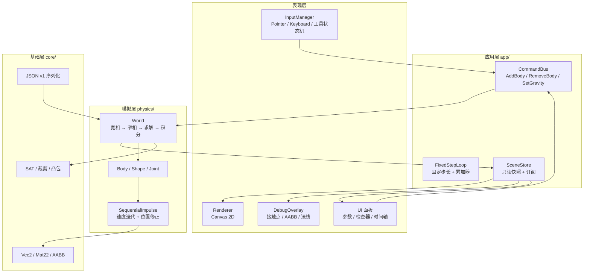
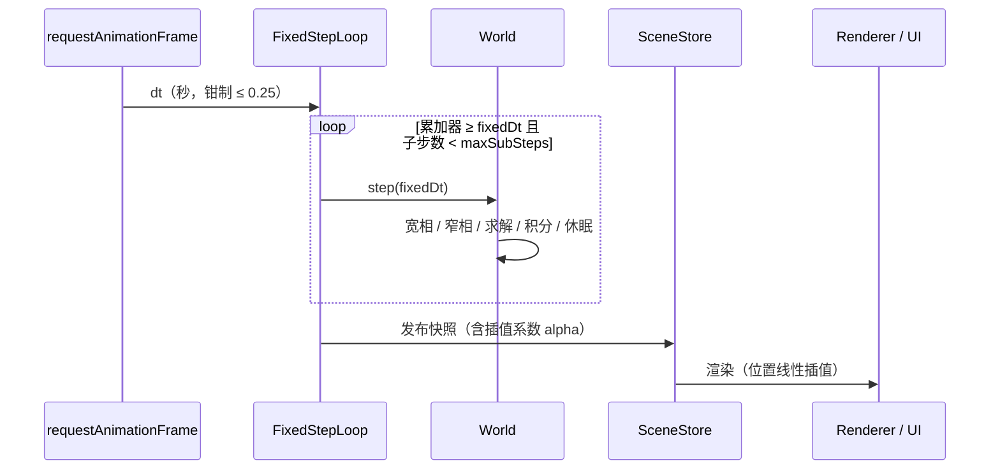

# Field · 2D 物理模拟器设计文档

| 项目 | 内容 |
| --- | --- |
| 版本 | v0.1（草案） |
| 日期 | 2026-10-31 |
| 状态 | 待评审 |
| 技术栈 | TypeScript 5.x + Vite + Canvas 2D |
| 目标平台 | 现代浏览器（Chrome / Edge / Firefox / Safari，桌面优先） |

---

## 1. 背景与定位

**Field** 是一个运行在浏览器里的 2D 刚体物理沙盒。用户打开网页即可放置物体、拖拽交互、调整重力与材料参数，并用浏览器原生的交互方式观察物理行为。它同时是一个**可嵌入的确定性 2D 物理引擎**：核心层不依赖 DOM，可在 Node 环境跑无头测试与回放。

一句话定位：

> 打开即玩的 2D 物理沙盒，稳定的刚体模拟，场景可保存、可回放、可分享。

命名 `Field` 有两层含义：既是"物理场"（重力场、力场），也是"试验场"（sandbox / playground）。

---

## 2. 目标与非目标

### 2.1 目标（v0.1 必须达成）

1. **稳定的 2D 刚体模拟**：圆形、凸多边形、复合形状；支持重力、摩擦、弹性、休眠。
2. **交互式编辑**：鼠标/触控拖拽物体、创建与删除物体、平移缩放画布。
3. **关节系统**：距离、旋转（revolute）、焊接、弹簧、鼠标关节。
4. **时间控制**：暂停 / 单步 / 0.25×–4× 倍速 / 重置。
5. **场景持久化**：JSON v1 格式导入导出，内置 3 个示例场景。
6. **调试可视化**：接触点、法线、AABB、速度矢量、休眠状态着色。
7. **确定性**：相同场景 + 相同输入序列 ⇒ 相同结果（浮点容差内），支持回放测试。
8. **性能**：中端笔记本上 200 动态刚体 + 400 静态刚体保持 60 FPS。

### 2.2 非目标（明确不做，避免范围蔓延）

- 3D 物理、流体、软体（软体作为 v0.3 之后的实验特性，不进 v0.1）。
- 连续碰撞检测（CCD / 高速子弹），v0.1 仅做离散检测 + 速度钳制。
- 多人实时协作、服务端物理、云存档。
- 移动端完整手势适配（仅保证页面可用，不做专门布局优化）。
- 脚本化用户 API（如"用 JS 控制物体"），列入开放问题。

---

## 3. 目标用户与场景

| 用户 | 典型诉求 | 对应能力 |
| --- | --- | --- |
| 好奇的普通用户 | 打开网页，随便玩玩"堆箱子 / 摆多米诺" | 内置示例、零学习成本的操作、拖拽即生效 |
| 学生 / 教师 | 直观理解重力、摩擦、动量守恒 | 参数面板、慢放、速度矢量与接触点可视化 |
| 游戏 / 前端开发者 | 参考或复用一个小型 2D 物理引擎 | `core/` 零依赖、可 headless、API 文档、npm 可发布 |
| 内容创作者 | 做一段物理演示并分享 | 场景 JSON 导出、URL 分享（v0.2） |

---

## 4. 技术选型

| 维度 | 选择 | 理由 | 备选方案 |
| --- | --- | --- | --- |
| 语言 | TypeScript 5.x，`strict: true` | 数值代码多，类型能显著降低接错参数的概率 | JavaScript（无类型，易出错） |
| 构建 | Vite | 秒级冷启动、原生 ESM、静态产物极小 | Webpack（重）、Parcel |
| 渲染 | **Canvas 2D（v0.1）** | 2D 图元绘制简单、调试友好、跨浏览器稳定 | WebGL2（留给 v0.3 的性能升级路径） |
| UI | 原生 DOM + 轻量自研 store | 面板规模小，避免引入框架与虚拟 DOM 开销 | React / Preact |
| 物理 | **自研**（Sequential Impulse，参考 Box2D-lite 思路） | 完全可控、可确定性、可教学、体积小 | Rapier / Matter.js / planck.js |
| 测试 | Vitest（单元 + 无头模拟）、Playwright（e2e 冒烟） | 快、与 Vite 同生态 | Jest（配置重） |
| 代码质量 | ESLint + Prettier + `tsc --noEmit` + CI | 保证提交门槛 | 仅靠人工 review |
| 部署 | 静态托管（GitHub Pages / 平台一键部署） | 无后端，纯静态 | 自建服务器 |

> 自研而非引入现成引擎，是本项目"可确定性、可解释、体积可控"目标的一部分；代价是稳定性调参需要迭代（见 §17 风险）。

---

## 5. 总体架构

四层单向依赖：**基础层 → 模拟层 → 表现层 → 应用层**。`core/` 与 `physics/` 绝不 import DOM 或渲染代码，保证可无头运行。



**数据流原则**：输入与 UI 只能通过命令修改世界；渲染与 UI 只读取不可变快照。避免"渲染层回写物理状态"导致的隐式耦合。

### 5.1 帧循环



- `dt` 来自 `requestAnimationFrame`，切后台/卡顿导致的超大 `dt` 被钳制，避免"一次跳很多步"。
- 首帧与单步模式下 `alpha` 取 0，避免视觉滑移。

---

## 6. 目录结构

```text
field/
├─ docs/
│  └─ DESIGN.md                 # 本文档
├─ public/                      # 静态资源（图标等）
├─ src/
│  ├─ core/                     # 基础层：零 DOM 依赖
│  │  ├─ math/
│  │  │  ├─ vec2.ts             # Vec2 运算（对象式 + 就地变体）
│  │  │  ├─ mat22.ts            # 2×2 旋转矩阵
│  │  │  └─ aabb.ts
│  │  ├─ geometry/
│  │  │  ├─ convex-hull.ts      # 顶点凸包化 + 退化剔除
│  │  │  ├─ sat.ts              # SAT 求最大分离轴
│  │  │  └─ clip.ts             # 参考面/入射面裁剪
│  │  └─ utils/
│  │     ├─ rng.ts              # 可种子化随机数
│  │     └─ assert.ts           # 开发期断言（生产被裁剪）
│  ├─ physics/                  # 模拟层
│  │  ├─ shape.ts               # Circle / Polygon / Compound
│  │  ├─ body.ts                # 刚体状态与质量属性
│  │  ├─ broadphase.ts          # 空间哈希（v0.1）
│  │  ├─ narrowphase.ts         # 流形生成
│  │  ├─ manifold.ts            # 接触点缓存与 warm start 键
│  │  ├─ solver.ts              # 顺序冲量求解器
│  │  ├─ joints/                # 5 种关节
│  │  ├─ island.ts              # 休眠岛划分（v0.2）
│  │  ├─ world.ts               # 世界门面：step / query / raycast
│  │  └─ index.ts
│  ├─ render/
│  │  ├─ camera.ts              # 世界↔屏幕变换
│  │  ├─ renderer.ts
│  │  └─ debug-overlay.ts
│  ├─ input/
│  │  ├─ pointer.ts
│  │  └─ tools/                 # select / spawn / joint / erase / pan
│  ├─ ui/
│  │  ├─ panels/                # 世界参数 / 检查器 / 场景
│  │  └─ store.ts
│  ├─ persistence/
│  │  ├─ schema.ts              # 场景 JSON v1 类型 + 校验
│  │  └─ migrate.ts             # 版本迁移
│  ├─ scenes/                   # 内置示例场景（JSON）
│  ├─ app/
│  │  ├─ main.ts
│  │  └─ loop.ts
│  └─ styles/
├─ tests/
│  ├─ unit/                     # 数学 / 碰撞 / 求解器
│  └─ replay/                   # 确定性回放快照
├─ index.html
├─ package.json
├─ tsconfig.json
└─ vite.config.ts
```

---

## 7. 物理引擎设计（核心）

### 7.1 坐标系、单位与约定

- 世界使用**米**为单位，**Y 轴向上**（重力默认 `(0, -9.81)`）。
- 角度使用**弧度**；渲染层负责 Y 轴翻转（`screenY = originY - worldY`）。
- 默认渲染比例 `1 m = 40 px`，画布使用 `devicePixelRatio` 缩放。
- 所有内部计算使用 `number`（float64）；不引入定点数（跨平台差异用容差断言处理，见 §13）。
- 刚体同时缓存 `sin/cos`：`setAngle()` 时更新，求解器热路径不做三角函数。

### 7.2 刚体数据模型

| 字段 | 类型 | 说明 |
| --- | --- | --- |
| `id` | `BodyId` | 单调递增整数，用于稳定排序与序列化 |
| `type` | `dynamic / static / kinematic` | 静态质量视为无穷大，kinematic 由速度驱动 |
| `position` | `Vec2` | 质心世界坐标 |
| `angle` | `number` | 弧度 |
| `linearVelocity` | `Vec2` | 质心线速度 |
| `angularVelocity` | `number` | 角速度 rad/s |
| `mass` / `invMass` | `number` | 由形状与密度推导 |
| `inertia` / `invInertia` | `number` | 绕质心转动惯量 |
| `shape` | `Shape` | 圆 / 凸多边形 / 复合 |
| `material` | `{ density, friction, restitution }` | 接触时取两体几何平均（或按规则） |
| `fixedRotation` | `boolean` | 锁定旋转（invInertia = 0） |
| `allowSleep` | `boolean` | 默认动态体为 true |
| `sleepState` | `awake / sleepy / asleep` | 见 §7.8 |
| `aabb` | `AABB` | 每步更新，供宽相使用 |
| `userData` | `unknown` | 渲染/业务附加信息（颜色、标签） |

质量属性由形状在**局部坐标**下计算：

- 圆：`A = πr²`，`I = ½ m r²`
- 凸多边形：面积用鞋带公式；质心与惯量用标准多边形积分公式，之后将顶点平移到质心坐标系。

### 7.3 时间步进

固定步长 + 累加器，与渲染解耦：

```ts
const MAX_FRAME_DT = 0.25; // 秒
let accumulator = 0;
let alpha = 0;

function frame(now: number) {
  const rawDt = Math.min((now - lastTime) / 1000, MAX_FRAME_DT);
  lastTime = now;
  accumulator += rawDt * timeScale;

  let steps = 0;
  while (accumulator >= fixedDt && steps < maxSubSteps) {
    world.step(fixedDt);
    accumulator -= fixedDt;
    steps++;
  }
  // 步数打满仍落后：丢弃余额，避免"死亡螺旋"
  if (steps === maxSubSteps) accumulator = 0;

  alpha = accumulator / fixedDt;
  renderer.render(world.snapshot(alpha));
  requestAnimationFrame(frame);
}
```

默认参数：`fixedDt = 1/60 s`、`maxSubSteps = 4`、`velocityIterations = 8`、`positionIterations = 3`。允许用户在参数面板调整（1/120 更稳但更贵）。

### 7.4 单步管线


步骤 5–6 与 7 的顺序固定，保证确定性；接触求解顺序按 `(bodyA.id, bodyB.id, featureId)` 排序后遍历。

### 7.5 宽相（Broad Phase）

v0.1 采用**空间哈希（均匀网格）**：

- 单元格边长取 `2 × 当前最大外接圆半径`（每 60 帧重算一次并重建网格，避免长条物体退化）。
- 每个刚体按其 AABB 覆盖的所有单元格插入（静态体可懒插入并只做一次）。
- 候选对去重：`pairKey = min(idA,idB) * 2^32 + max(idA,idB)`，用 `Set` 或排序数组去重。
- 升级路径（v0.3）：动态 AABB 树（Box2D b2DynamicTree 思路），用于大规模静态场景；接口保持 `broadphase.pairs()` 不变，可插拔。

### 7.6 窄相与接触流形

| 形状对 | 算法 | 关键点 |
| --- | --- | --- |
| 圆–圆 | 圆心距 vs 半径和 | 1 个接触点，法线为圆心连线 |
| 圆–多边形 | 圆心到各边最近点 | 点在多边形内时退化为"边法线最近面" |
| 多边形–多边形 | SAT 求最大分离轴 + 参考面/入射面裁剪 | 最多 2 个接触点 |

多边形 SAT 与裁剪流程：

1. 对 A、B 的每条边法线求投影区间重叠，得到各轴分离量；任一轴分离量 > 0 ⇒ 无碰撞，提前返回。
2. 取**分离量最大**的轴作为参考面（属于 A 或 B）。
3. 在另一多边形上找与参考法线最反向的入射面。
4. 用参考面的两个侧平面裁剪入射面，保留 `separation <= 0 + slop` 的点作为接触点（最多 2 个）。
5. 计算每个接触点的累积冲量缓存键：`featureId = (refFaceIndex × 16) + vertexIndex`，与体 ID 组合构成稳定键，用于跨帧 warm start。

退化处理：多边形创建时统一走 `convexHull()`；面积小于 `1e-6 m²` 或顶点少于 3 个则拒绝创建并给出警告。

### 7.7 顺序冲量求解器（Sequential Impulse）

每个接触点构建一维法向约束与二维摩擦（切向）约束。设：

- 法线 `n`，切线 `t = perp(n)`
- `rA = p - cA`，`rB = p - cB`（接触点到两体质心的杠杆臂）
- 有效质量 `K = invMassA + invMassB + invIA·(rA×n)² + invIB·(rB×n)²`

求解流程（每个速度迭代内，对每个接触点）：

```text
相对法向速度 vn = (vB + ωB×rB - vA - ωA×rA)·n
目标：vn' ≥ 0（不分离），并吸收 Baumgarte 位置偏置与恢复系数

1) 恢复系数：vn < -restitutionThreshold 时
     bias = -e * vn，否则 bias = 0
2) 冲量增量 λ = -(vn + bias + positionBias) / K
3) 累积并钳制：accN = max(accN + λ, 0)，实际施加 Δ = accN - 旧accN
4) 施加：vA -= invMassA * Δ * n；ωA -= invIA * (rA×n) * Δ（B 同理取反）
5) 摩擦：vt = 相对速度·t；λt = -vt / Kt
   accT 钳制在 [-μ·accN, +μ·accN]，施加同理
```

参数与稳定化策略：

| 参数 | 默认值 | 作用 |
| --- | --- | --- |
| `velocityIterations` | 8 | 堆叠稳定性与成本的主要权衡点 |
| `positionIterations` | 3 | 伪位置冲量修正穿透（split impulse，不污染速度） |
| `baumgarte` | 0.2 | 位置误差反馈强度，过大导致"弹开" |
| `slop` | 0.005 m | 允许的穿透容差，防止接触抖动 |
| `restitutionThreshold` | 1.0 m/s | 低速接触不反弹，避免"永不静止" |
| 最大线速度 | 40 m/s | 速度钳制，降低穿隧风险 |

其他稳定性规则：

- **Warm start**：每步开始时先施加上一帧累积冲量，显著减少堆叠抖动。
- **质量比限制**：动态刚体质量与场景中位数质量比超过 100:1 时给出警告（极端质量比是抖动主因）。
- **NaN 守卫**：每次积分后检查 `Number.isFinite`，命中则冻结该体、停止其参与求解并派发 `diagnostics` 事件（而不是让整个页面崩掉）。
- **休眠**（§7.8）减少无效求解，同时让静止堆叠完全稳定。

### 7.8 休眠

- 判定：线速度 < `0.05 m/s`、角速度 < `0.05 rad/s` 持续 `0.5 s` ⇒ `sleepy → asleep`。
- 唤醒：任一相邻体 awake、受到外力/关节驱动、被编辑（拖拽/修改属性）。
- v0.1 用"按体计时器"实现；v0.2 升级为**接触岛（island）**整体休眠，避免"岛内部分休眠"造成的缓慢漏能。

### 7.9 关节

| 关节 | 约束（消除自由度） | 关键实现 |
| --- | --- | --- |
| `distance` | 两点距离保持 | 沿连线方向的 1D 约束，可选软约束（频率/阻尼比） |
| `revolute` | 移除相对平移（保留旋转） | 2D 点约束 + 可选角度限位与马达 |
| `weld` | 移除相对平移与旋转 | revolute + 角度约束 |
| `spring` | 软距离约束 | 软约束形式（frequencyHz / dampingRatio），不硬钳制 |
| `mouse` | 把鼠标目标当作"软锚点" | 质量归一化的软约束，`maxForce` 限制 |

**拖拽必须用 mouse joint 而不是直接写位置**：直接写位置会制造无穷大速度、穿透与"爆炸"。mouse joint 用软约束 + 力上限，物理上更自然（参考 Box2D `b2MouseJoint`）。

软约束参数（distance/spring 软模式）：

```text
omega = 2π·frequencyHz
zeta  = dampingRatio
bias  = C·(omega·dt) / (zeta + omega·dt)
gamma = 1 / (dt·(zeta + omega·dt))
```

### 7.10 已知限制（v0.1 必须写进文档与 UI 提示）

- 无 CCD：极快小物体可能穿隧（用速度钳制缓解）。
- 凸多边形之间的凹陷/薄片堆叠仍可能抖动（迭代数上限决定）。
- 极端质量比（>100:1）不稳定。
- 复合形状按整体刚体处理，不做形状间自碰撞。

---

## 8. 渲染设计

### 8.1 相机

```ts
interface Camera {
  center: Vec2;   // 世界坐标
  zoom: number;   // 像素/米
  viewport: { width: number; height: number }; // CSS 像素
}
```

- 世界→屏幕：`sx = viewport.w/2 + (wx - cam.center.x) * zoom`，`sy = viewport.h/2 - (wy - cam.center.y) * zoom`。
- 滚轮缩放以指针为锚点（缩放前后光标下的世界点不变）。
- 平移：空格 + 拖拽，或中键拖拽；触控双指缩放列为 v0.2。

### 8.2 渲染管线（Canvas 2D）

每帧绘制顺序：

1. 背景网格（按 zoom 自适应主/次网格线，缩放 < 0.5 时隐藏次线）
2. 静态刚体（批量同色路径）
3. 关节（线段 + 锚点）
4. 动态刚体（**插值位置** = `prev * (1-alpha) + curr * alpha`；角度按最短弧插值）
5. 选中/悬停高亮
6. 调试层（接触点、法线、AABB、速度矢量、休眠着色）

性能措施：

- 形状轮廓使用 `Path2D` 缓存（按 `shapeId + 缩放档位` 复用），每帧只做 `translate/rotate + fill/stroke`。
- 屏幕外 AABB 剔除（用世界 AABB 与视口 AABB 求交）。
- 文字与面板全部走 DOM，不画在 Canvas 上。
- 当 `bodyCount > 1000` 自动降级：关闭阴影、细描边、跳格绘制。

### 8.3 调试可视化

| 开关 | 显示 |
| --- | --- |
| `debug.aabb` | 响应式 AABB（宽相候选对用不同颜色） |
| `debug.contacts` | 接触点（黄点）+ 法线（青线）+ 冲量大小（线长） |
| `debug.velocity` | 质心速度矢量 |
| `debug.sleep` | awake 正常色 / sleepy 黄框 / asleep 灰化 |
| `debug.stats` | 体数、接触数、每步耗时（物理/渲染分列） |

---

## 9. 交互与工具

工具状态机：`select`（默认） / `spawn`（圆形/矩形/多边形） / `joint`（距离/旋转/弹簧） / `erase` / `pan`。

| 操作 | 行为 |
| --- | --- |
| 左键拖拽物体 | 创建 mouse joint，松开销毁 |
| 左键点空白 | 取消选中 |
| 网格拖拽（多选） | 框选（v0.2） |
| 右键 / `E` | 删除悬停物体 |
| 滚轮 | 以指针为锚点缩放 |
| 空格 + 拖拽 / 中键 | 平移 |
| `Space` | 暂停 / 继续 |
| `S` | 单步 |
| `R` | 重置场景 |
| `D` | 切换调试层 |
| `Ctrl+Z / Ctrl+Shift+Z` | 撤销 / 重做（命令栈，v0.2） |

命中测试顺序：`world.queryPoint(p)` 取最上层（最后创建且 `pickable`）的动态体；静态体可拖但默认锁定（`locked` 标记）。

---

## 10. UI 面板

- **顶栏**：播放/暂停、单步、倍速（0.25×/0.5×/1×/2×/4×）、重置、导入、导出、示例场景下拉。
- **世界参数**：重力 `gx/gy`（滑杆 + 数值）、固定步长、迭代次数、休眠开关、调试开关。
- **检查器**：选中体的类型、位置、角度、速度、质量、密度、摩擦、弹性、颜色；只读区展示接触数。
- **场景面板**：场景名、物体计数、保存到本地（localStorage 最近 5 个）。
- **状态栏**：FPS、体数、接触对数、物理/渲染耗时。

UI 不直接持有 `World` 引用，只通过 `CommandBus` 下发命令，并通过 `SceneStore` 订阅快照刷新。

---

## 11. 场景格式（JSON v1）

```json
{
  "version": 1,
  "name": "Box Stack",
  "gravity": [0, -9.81],
  "settings": {
    "fixedDt": 0.016666666666666666,
    "velocityIterations": 8,
    "positionIterations": 3,
    "allowSleep": true
  },
  "camera": { "center": [0, 5], "zoom": 40 },
  "bodies": [
    {
      "id": 1,
      "type": "static",
      "position": [0, 0],
      "angle": 0,
      "shape": { "type": "polygon", "vertices": [[-10, -0.5], [10, -0.5], [10, 0.5], [-10, 0.5]] },
      "material": { "density": 1, "friction": 0.6, "restitution": 0 },
      "userData": { "color": "#334155" }
    },
    {
      "id": 2,
      "type": "dynamic",
      "position": [0, 3],
      "angle": 0.1,
      "shape": { "type": "circle", "radius": 0.5 },
      "material": { "density": 1, "friction": 0.5, "restitution": 0.2 },
      "userData": { "color": "#38bdf8" }
    }
  ],
  "joints": [
    { "type": "distance", "a": 2, "b": 3, "anchorA": [0, 0], "anchorB": [0, 0], "length": 2.0 }
  ]
}
```

约束与校验规则：

- 解析后必须通过 `validateScene()`；失败给出**字段级**错误（`bodies[2].shape.vertices: 顶点不足 3 个`），不静默吞掉。
- `id` 必须唯一且为正整数；缺失时按顺序补号，但会提示"已自动补号"。
- 未知字段保留在 `extras` 中，保证向前兼容（v1 读取 v2 文件时不丢数据）。
- `migrate.ts` 按 `version` 逐级升级；写入永远输出当前版本。
- 导出时对数值保留 6 位小数，减少文件体积与 diff 噪声。

---

## 12. 性能预算

目标设备：2020 年后中端笔记本（4 核 / 16GB / 集显），Chrome 120+。

| 指标 | 目标 | 测量方式 |
| --- | --- | --- |
| 稳态帧率 | 60 FPS（200 动态 + 400 静态） | 连续 10s 的 p95 帧时间 ≤ 16.7ms |
| 物理耗时 | ≤ 5 ms / 帧（上述场景） | `performance.now()` 包裹 `world.step` |
| 渲染耗时 | ≤ 5 ms / 帧 | 同上，包裹渲染 |
| 内存 | 稳态无持续增长（5 分钟 Δ < 5MB） | 浏览器 Memory 面板采样 |
| 启动 | 首帧 < 1.5 s | Performance timeline |
| 大场景降级 | 1000 体 ≥ 30 FPS | 自动降级生效后测 |

优化手段（按优先级）：

1. 热路径零分配：求解器复用临时向量（模块级 scratch 对象），禁止在 `step` 内 `new`。
2. 数值就地运算：`Vec2` 提供 `addInPlace/subInPlace` 等变体。
3. 接触对与流形用**对象池**复用，按帧回收。
4. 休眠 + 岛划分，跳过静止堆叠的求解。
5. 渲染剔除 + `Path2D` 缓存 + 细粒度脏标记（v0.3）。
6. WebGL2 批量实例化渲染（v0.3，仅在 Canvas 2D 实测触顶后启用）。

---

## 13. 确定性与测试

### 13.1 确定性规则

- 物理只由 `world.step(dt)` 驱动，dt 恒定；所有随机性（如"随机生成场景"）走可种子化 `rng`。
- 碰撞对、接触点、求解顺序均按稳定键排序，不依赖 `Map` 迭代顺序或创建时机。
- 热路径禁用三角函数：角度变化时缓存 `sin/cos`。
- 不用 `Math.random`、`Date.now`、`Promise`、`requestAnimationFrame` 于 `core/physics`。
- 跨平台浮点差异用**容差**处理（见下），不追求 bit-exact。

### 13.2 测试矩阵

| 层级 | 内容 | 工具 |
| --- | --- | --- |
| 单元 | `Vec2/Mat22/AABB`、凸包、SAT、裁剪、质量/惯量公式 | Vitest |
| 物理行为 | 单球自由落体解析解误差 < 1%；球静止在斜面上不滑（摩擦角内）；10 层箱堆 10s 内位移 < 2cm | Vitest 无头 |
| 确定性回放 | 记录初始场景 + 1000 步，比对最终状态（位置容差 1e-6，速度 1e-5） | Vitest + 快照文件 |
| 属性测试 | 任意合法场景模拟 500 步：无 NaN、无 |速度| > 40、总能量不增（弹性=0 时单调不增） | fast-check（可选） |
| 序列化 | 导出→导入→导出，语义等价；非法输入给出字段级错误 | Vitest |
| e2e 冒烟 | 打开页面、加载示例、拖拽一个物体、导出场景 | Playwright |

CI 门禁：`lint` → `typecheck` → `test` → `build`，全绿方可合并。

---

## 14. 错误处理与边界

- **输入校验**：所有用户输入（导入 JSON、参数滑杆）在边界处校验；物理层信任内部数据。
- **数值守卫**：`step` 后检查非有限值；命中即冻结体并上报，不清空整个场景。
- **资源上限**：单场景最多 2000 刚体、500 关节；超限拒绝并提示。
- **退化几何**：自动凸包 + 最小面积过滤；退化时抛 `InvalidShapeError` 并在 UI 提示。
- **渲染健壮性**：`Path2D` 构建失败时跳过该体绘制，不阻塞整帧。
- **错误上报**：v0.1 仅控制台 + 状态栏提示，不接入第三方监控。

---

## 15. 里程碑

| 里程碑 | 范围 | 验收标准（DoD） |
| --- | --- | --- |
| **M0 骨架** | Vite + TS + ESLint + Vitest + CI；目录与接口占位 | `npm run dev/build/test` 全通过；CI 绿 |
| **M1 物理核心** | 数学库、凸包、SAT、流形、求解器、积分、休眠 | 圆球落地解析误差 < 1%；10 层箱堆 10s 稳定；单元 + 回放测试通过 |
| **M2 渲染与交互** | 相机、Canvas 渲染、拖拽（mouse joint）、创建/删除、平移缩放 | 200 体场景 60 FPS；拖拽不穿透不爆冲；调试层可切换 |
| **M3 关节与场景** | 5 种关节、JSON v1 导入导出、3 个示例、撤销栈（可选） | 关节示例可玩；导出→导入结果等价；回放测试纳入 CI |
| **M4 打磨发布** | UI 面板、性能优化、文档、部署 | 达到 §12 全部性能指标；公开可访问；打 `v0.1.0` tag |

依赖关系：M1 是硬前置；M2 可与 M1 部分并行（渲染只依赖快照格式）；M3 依赖 M1+M2。

---

## 16. 关键接口草案

```ts
export type Vec2 = { x: number; y: number };
export type BodyId = number;

export interface WorldOptions {
  gravity?: Vec2;                 // 默认 (0, -9.81)
  fixedDt?: number;               // 默认 1/60
  velocityIterations?: number;    // 默认 8
  positionIterations?: number;    // 默认 3
  maxSubSteps?: number;           // 默认 4
  allowSleep?: boolean;           // 默认 true
}

export interface BodyDef {
  type: 'dynamic' | 'static' | 'kinematic';
  position: Vec2;
  angle?: number;
  shape: ShapeDef;
  material?: { density?: number; friction?: number; restitution?: number };
  fixedRotation?: boolean;
  userData?: unknown;
}

export type ShapeDef =
  | { type: 'circle'; radius: number }
  | { type: 'polygon'; vertices: Vec2[] }          // 自动凸包化
  | { type: 'compound'; parts: ShapeDef[] };

export interface World {
  createBody(def: BodyDef): BodyId;
  destroyBody(id: BodyId): void;
  createJoint(def: JointDef): JointId;
  destroyJoint(id: JointId): void;

  step(dt: number): void;                          // 固定步长语义
  snapshot(alpha?: number): WorldSnapshot;         // 只读渲染数据

  queryPoint(p: Vec2): BodyId[];                   // 命中测试
  queryAABB(box: AABB, mask?: QueryMask): BodyId[];
  raycast(origin: Vec2, dir: Vec2, maxDist: number): RaycastHit | null;
}
```

> `snapshot()` 返回**扁平只读结构**（TypedArray 或普通数组由实现决定），避免渲染层持有可变物理对象；具体字段在 M2 冻结并写入 README。

---

## 17. 风险与取舍

| 风险 | 影响 | 缓解 / 决策 |
| --- | --- | --- |
| 自研求解器调参成本高，堆叠抖动 | 用户体验的核心指标 | 先对齐 Box2D-lite 参数；用固定的"10 层箱堆 10s"回归测试锁死稳定性 |
| Canvas 2D 在大量物体时触顶 | 大场景无法 60 FPS | 自动降级 + 剔除；预埋 WebGL2 渲染器接口（`Renderer` 接口不变） |
| 高长宽比 / 极细多边形不稳定 | 碰撞法线跳变 | 凸包 + 最小面积过滤 + 建议上限 20 顶点；文档明示限制 |
| 浮点跨平台差异 | 回放测试脆弱 | 容差断言；顺序稳定；不承诺 bit-exact |
| 拖拽制造穿透/爆炸 | 明显 bug 感 | 强制 mouse joint（软约束 + 力上限），禁止直接写位置 |
| 范围蔓延（流体/软体/脚本） | 交付延期 | §2.2 非目标 + 开放问题单独立项 |

---

## 18. 开放问题（需要产品决策）

1. **软体 / 流体**是否需要？若要，倾向"粒子 + PBF 流体"作为独立实验场景，不进入刚体核心。
2. **用户脚本 API**（在场景里写 JS 控制力/事件）是否作为 v0.4 特性？会影响 `core` 的安全边界（需沙箱或明确"可信用户"定位）。
3. `core` 是否发布为独立 npm 包（`@field/engine`）？若发布，API 稳定性与文档成本需要单独立项。
4. 是否支持 URL 分享场景（场景压缩进 hash）？与导出按钮的优先级排序。

---

## 附录 A：一次 `world.step` 的伪代码

```text
function step(dt):
    if dt <= 0: return
    updateForces()                    # 重力、用户外力、关节马达
    updateAABBs()
    pairs = broadphase.computePairs() # 空间哈希候选 + 去重
    contacts = narrowphase.generate(pairs)
    solver.prepare(contacts)          # warm start：施加上一帧累积冲量
    for i in 0..velocityIterations:
        for c in contacts: solveVelocity(c)
        for j in joints:   solveVelocity(j)
    integrateVelocities(dt)
    for i in 0..positionIterations:
        for c in contacts: solvePosition(c)
        for j in joints:   solvePosition(j)
    integratePositions(dt)
    updateSleepStates(dt)
    checkFiniteState()
    emitEvents()                      # 碰撞开始/结束等
```

## 附录 B：默认参数总表

| 参数 | 默认 | 范围（UI） |
| --- | --- | --- |
| 重力 | `(0, -9.81)` | `gx ∈ [-20,20]`，`gy ∈ [-30,10]` |
| 固定步长 | `1/60 s` | `1/120 s – 1/30 s` |
| 速度迭代 | 8 | 2 – 20 |
| 位置迭代 | 3 | 0 – 10 |
| 子步上限 | 4 | 1 – 8 |
| `baumgarte` | 0.2 | 0 – 0.4 |
| `slop` | 0.005 m | 0.001 – 0.02 m |
| 恢复系数阈值 | 1.0 m/s | 0.1 – 2.0 m/s |
| 最大线速度 | 40 m/s | 固定 |
| 休眠速度阈值 | 0.05 m/s、0.05 rad/s | 固定 |
| 休眠延时 | 0.5 s | 固定 |

## 附录 C：参考

- Erin Catto, *Iterative Dynamics with Temporal Coherence* / GDC 物理教程（顺序冲量、warm starting）。
- Box2D（b2DynamicTree、b2MouseJoint、b2ContactSolver 的公开实现思路）。
- "Separating Axis Theorem" 与多边形裁剪的标准接触生成流程。
